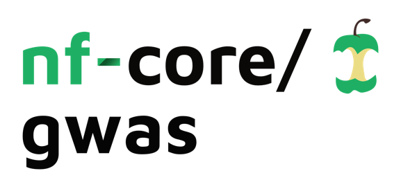

<h1>
  <picture>
    <source media="(prefers-color-scheme: dark)" srcset="docs/images/nf-core-gwas_logo_dark.png">
    
  </picture>
</h1>

[](https://github.com/codespaces/new/nf-core/gwas)
[](https://github.com/nf-core/gwas/actions/workflows/nf-test.yml)
[](https://github.com/nf-core/gwas/actions/workflows/linting.yml)[](https://nf-co.re/gwas/results)[](https://doi.org/10.5281/zenodo.XXXXXXX)
[](https://www.nf-test.com)

[](https://www.nextflow.io/)
[](https://github.com/nf-core/tools/releases/tag/4.0.3)
[](https://docs.conda.io/en/latest/)
[](https://www.docker.com/)
[](https://sylabs.io/docs/)
[](https://cloud.seqera.io/launch?pipeline=https://github.com/nf-core/gwas)

[](https://nfcore.slack.com/channels/gwas)[](https://bsky.app/profile/nf-co.re)[](https://mstdn.science/@nf_core)[](https://www.youtube.com/c/nf-core)

## Introduction

**nf-core/gwas** is a bioinformatics pipeline for genome-wide association and heritability analysis of genotyped cohorts. A cohort manifest owns genotype facts and an analysis manifest links each trait analysis to one cohort. This release validates the two linked manifests, prepares each cohort's genotypes and each analysis's phenotype and covariates once, and reports the run plan; the association and heritability routes that consume those prepared inputs are added in later releases, each registering its own method selector token.

Genotype quality control is not performed by the pipeline. Input genotypes must already have suitable samples, variants, alleles, coordinates, genome build and analysis filters.

## Pipeline summary

1. Validate the linked cohort and analysis manifests against their JSON schemas and cross-row contracts.
2. Prepare each distinct cohort once from PLINK 2 PGEN/PSAM/PVAR or PLINK 1 BED/BIM/FAM input, preserving the supplied representation and publishing one genotype view record per cohort.
3. Prepare the selected phenotype and optional quantitative and categorical covariates for each analysis.
4. Collect run and software provenance with MultiQC and Nextflow reports.

## Usage

> [!NOTE]
> If you are new to Nextflow and nf-core, please refer to [this page](https://nf-co.re/docs/get_started/environment_setup/overview) on how to set-up Nextflow. Make sure to [test your setup](https://nf-co.re/docs/get_started/run-your-first-pipeline) with `-profile test` before running the workflow on actual data.

Prepare a cohort manifest and an analysis manifest linked by `cohort_id`. Each cohort row declares exactly one complete genotype representation, PLINK 2 (`pgen`, `psam`, `pvar`) or PLINK 1 (`bed`, `bim`, `fam`); VCF input is not accepted. Each analysis row names one declared cohort, the trait and its headered phenotype file, and optional covariate files. The `association_methods` and `heritability_methods` selector cells stay empty in this release, which registers no method.

```csv title="cohorts.csv"
cohort_id,genome_build,ancestry,pgen,psam,pvar,bed,bim,fam
my_cohort,GRCh37,EUR,/data/my_cohort.pgen,/data/my_cohort.psam,/data/my_cohort.pvar,,,
```

```csv title="analyses.csv"
analysis_id,cohort_id,trait_id,trait_type,phenotype,phenotype_column,control_value,case_value,quant_covariates,cat_covariates,association_methods,heritability_methods,population_prevalence,sample_prevalence
height,my_cohort,height,quantitative,/data/phenotypes.tsv,height,,,,,,,,
```

Runnable examples are available under [`assets/examples/relational/`](assets/examples/relational/).

Then run:

```bash
nextflow run nf-core/gwas \
    -r <VERSION> \
    -profile docker \
    --cohort_manifest cohorts.csv \
    --analysis_manifest analyses.csv \
    --outdir results
```

> [!WARNING]
> Please provide pipeline parameters via the CLI or Nextflow `-params-file` option. Custom config files including those provided by the `-c` Nextflow option can be used to provide any configuration _**except for parameters**_; see [docs](https://nf-co.re/docs/running/run-pipelines#using-parameter-files).

For more details and further functionality, please refer to the [usage documentation](https://nf-co.re/gwas/usage) and the [parameter documentation](https://nf-co.re/gwas/parameters).

## Pipeline output

Every cohort publishes its genotype view record under `genotypes/<cohort_id>/`. Prepared phenotype and covariate files are published under `phenotypes/<analysis_id>/` when `--save_normalised_phenotypes` is set, and the MultiQC run report and Nextflow execution reports are published under `multiqc/` and `pipeline_info/`. Genotype files are never copied into the results directory.

To see the results of an example test run with a full size dataset refer to the [results](https://nf-co.re/gwas/results) tab on the nf-core website pipeline page.
For more details about the output files and reports, please refer to the
[output documentation](https://nf-co.re/gwas/output).

## Credits

nf-core/gwas was originally written by Chris Wyatt, Fernando Duarte, Maxime Laurent.

We thank the following people for their extensive assistance in the development of this pipeline:

<!-- TODO nf-core: If applicable, make list of people who have also contributed -->

## Contributions and Support

If you would like to contribute to this pipeline, please see the [contributing guidelines](docs/CONTRIBUTING.md).

For further information or help, don't hesitate to get in touch on the [Slack `#gwas` channel](https://nfcore.slack.com/channels/gwas) (you can join with [this invite](https://nf-co.re/join/slack)).

## Citations

<!-- TODO nf-core: Add citation for pipeline after first release. Uncomment lines below and update Zenodo doi and badge at the top of this file. -->
<!-- If you use nf-core/gwas for your analysis, please cite it using the following doi: [10.5281/zenodo.XXXXXX](https://doi.org/10.5281/zenodo.XXXXXX) -->

<!-- TODO nf-core: Add bibliography of tools and data used in your pipeline -->

An extensive list of references for the tools used by the pipeline can be found in the [`CITATIONS.md`](CITATIONS.md) file.

You can cite the `nf-core` publication as follows:

> **The nf-core framework for community-curated bioinformatics pipelines.**
>
> Philip Ewels, Alexander Peltzer, Sven Fillinger, Harshil Patel, Johannes Alneberg, Andreas Wilm, Maxime Ulysse Garcia, Paolo Di Tommaso & Sven Nahnsen.
>
> _Nat Biotechnol._ 2020 Feb 13. doi: [10.1038/s41587-020-0439-x](https://dx.doi.org/10.1038/s41587-020-0439-x).
